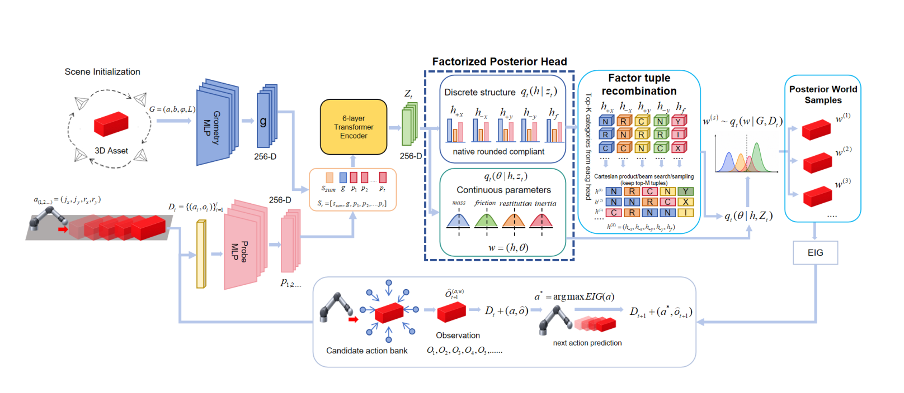
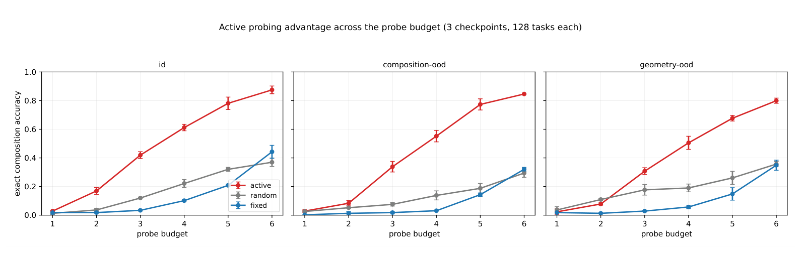
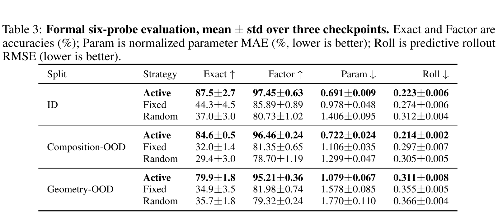
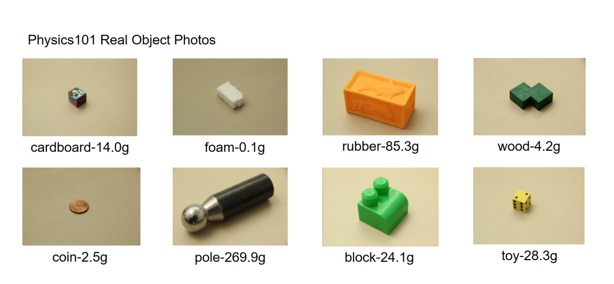
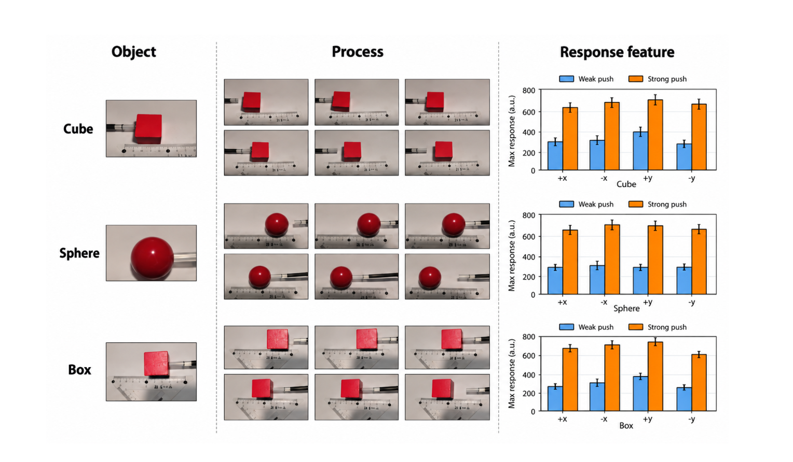
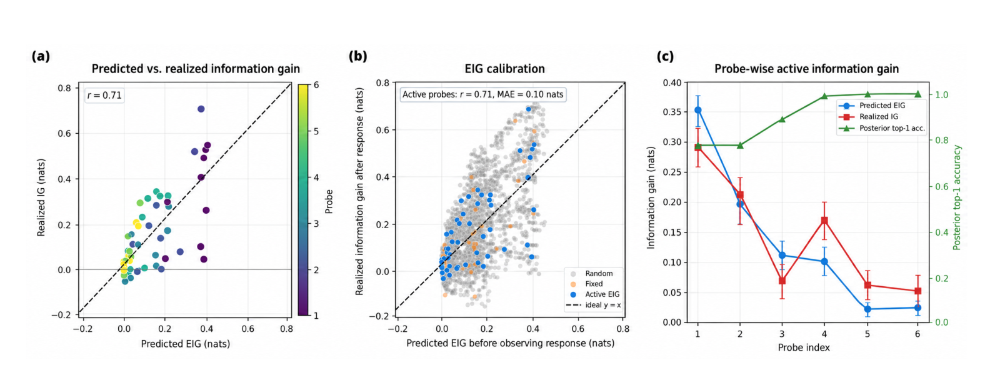
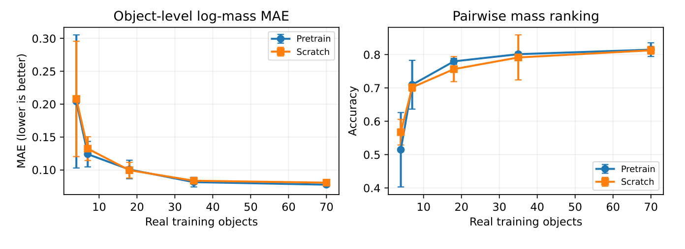
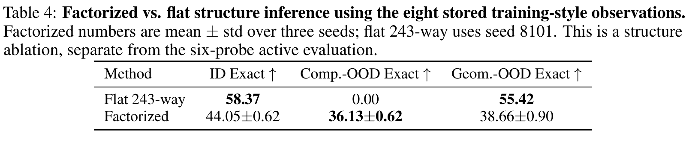
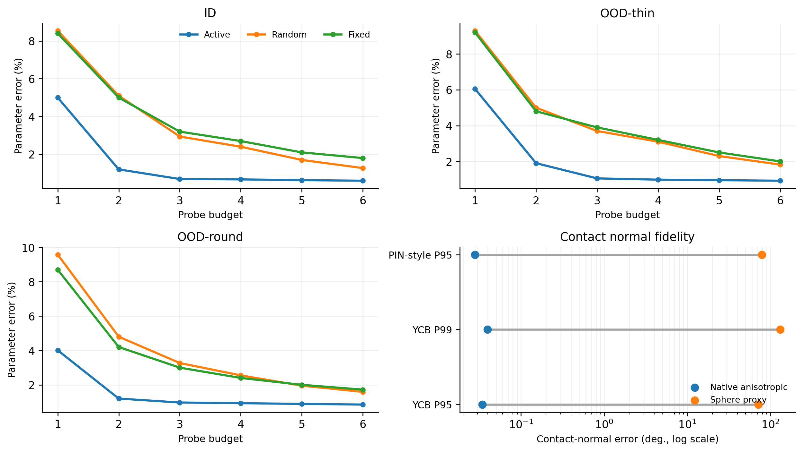
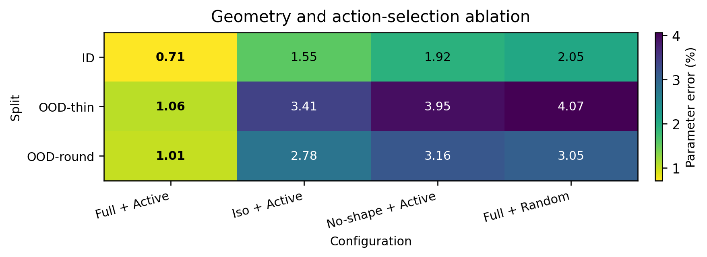

# ActiveContactGS

[](https://github.com/lyylovemwj/ActiveContactGS/actions/workflows/ci.yml)
[](pyproject.toml)
[](LICENSE)

Research code for **ActiveContactGS: Factorized Physical Hypotheses for Active Identification**.

<p align="center">
  
</p>
<p align="center"><em>ICLR Figure 1. A factorized physical-world posterior is recombined into joint worlds for expected-information-gain action selection.</em></p>

ActiveContactGS studies active rigid-body system identification from object-centric anisotropic Gaussian geometry. The codebase provides:

- differentiable planar rigid-body simulation with friction, restitution, off-centre impulses, and wall contact;
- contact computation on native anisotropic Gaussian ellipsoids;
- a factorized posterior over five three-state contact/friction factors and continuous physical parameters;
- amortized information-gain action selection from safe interaction candidates;
- pose-observation and Gaussian-video posterior models;
- 243-world ID/composition-OOD/geometry-OOD evaluation, real-data interfaces,
  identifiability analysis, YCB contact preparation, and PIN-WM reproduction helpers.

This lightweight GitHub package contains code, reproduction instructions,
high-resolution figures and tables extracted from the 16-page ICLR manuscript,
the earlier 3DV figure snapshot, and a compact reviewer asset suite. It does not
include checkpoints, generated datasets, full raw result JSON files, or logs.

## Quick Start

After installing the package on a CUDA machine, run:

```bash
python scripts/quickstart.py
```

This executes a small Active/Random/Fixed identification diagnostic and writes `outputs/quickstart/experiment.json` plus `analysis.json`. It checks the end-to-end path but does not reproduce the paper-scale experiment. See the [step-by-step Quick Start](docs/QUICKSTART.md).

## Installation

Python 3.10+ and PyTorch 2.1+ are required. Full training and evaluation require a CUDA GPU.

```bash
git clone https://github.com/lyylovemwj/ActiveContactGS.git
cd ActiveContactGS
python -m venv .venv
source .venv/bin/activate
python -m pip install --upgrade pip
python -m pip install -e ".[analysis,assets,dev]"
```

On Windows PowerShell, activate with `.venv\Scripts\Activate.ps1`.

For the frozen CUDA environment used in the experiments, see [environment.yml](environment.yml).

## Installation check

```bash
python -c "import torch, active_contact_gs; print(torch.__version__)"
python -m pytest --collect-only -q
```

Experiment entry points are intentionally GPU-only. Use `scripts/quickstart.py` for the cross-platform CUDA diagnostic or `scripts/smoke_test.sh` from Bash.

## ICLR paper results

<p align="center">
  
</p>
<p align="center"><em>ICLR Figure 3. Active probing separates from Random and Fixed as the probe budget grows across ID and both OOD splits.</em></p>

<p align="center">
  
</p>
<p align="center"><em>ICLR Table 3. Formal six-probe evaluation over three checkpoints; Active is strongest on every split.</em></p>

### Real-data evidence

<table>
  <tr>
    <td width="45%"></td>
    <td width="55%"></td>
  </tr>
  <tr>
    <td align="center">Figure 2. Physics101 transfer objects</td>
    <td align="center">Figure 5. Cube, sphere, and box contact sequences</td>
  </tr>
</table>

### Information gain and low-label transfer

<table>
  <tr>
    <td width="55%"></td>
    <td width="45%"></td>
  </tr>
  <tr>
    <td align="center">Figure 6. Predicted versus realized information gain</td>
    <td align="center">Figure 4. Corrected low-label sweep</td>
  </tr>
</table>

<details>
<summary><strong>Table 4: factorized versus flat structure inference</strong></summary>
<p align="center">
  
</p>
</details>

<details>
<summary><strong>Earlier 3DV geometry diagnostics</strong></summary>
<p align="center">
  
</p>
<p align="center">
  
</p>
</details>

The figures above are extracted from the supplied manuscript PDFs rather than
redrawn. Figure provenance, page mapping, and source checksums are recorded in
[`assets/images/README.md`](assets/images/README.md). Machine-readable sources
for the additional reviewer experiments remain in `paper_assets/iclr_review/`.

## ICLR reviewer experiment suite

The independent 16-page ICLR reconstruction adds four posterior
representations, composition/geometry OOD splits, model-mismatch and
identifiability diagnostics, and a richer set of paper assets. See the
[protocol and numerical results](docs/ICLR_REPRODUCTION.md) and the
[claim-to-asset index](paper_assets/iclr_review/README.md). The asset snapshot
includes vector PDF, PNG, LaTeX, and source CSV versions; full checkpoints and
evaluation JSON files remain external.

## Full CUDA pipeline

```bash
# Generate deterministic procedural shards.
python -m active_contact_gs.generate_amortized_dataset \
  --output data/amortized-v1 --train-tasks 131072 \
  --validation-tasks 16384 --test-tasks 16384 --probes 6

# Train one model.
python -m active_contact_gs.train_amortized \
  --data data/amortized-v1 --output outputs/main-seed7301 \
  --steps 16000 --batch-size 2048 --width 256 --layers 6 --heads 8 \
  --seed 7301 --geometry-mode full --observation-mode pose

# Evaluate Active, Random, and Fixed policies.
python -m active_contact_gs.evaluate_amortized \
  --checkpoint outputs/main-seed7301/checkpoint-latest.pt \
  --output outputs/main-seed7301/eval.json \
  --tasks 128 --probes 6 --strategies active random fixed
```

The complete three-seed, ablation, video, YCB, and PIN-WM protocols are in [docs/REPRODUCIBILITY.md](docs/REPRODUCIBILITY.md). CLI options are the source of truth and can be inspected with `python -m <module> --help`.

## Tests

The formal test suite exercises CUDA kernels and therefore requires a CUDA-capable runner:

```bash
python -m pytest -q
```

Standard GitHub-hosted CPU runners execute nine analytic/model tests and skip 27 explicitly marked CUDA tests. A CUDA runner executes all 36 tests. Run the complete GPU suite before tagging a release.

## Repository structure

```text
src/active_contact_gs/   Core method, training, evaluation, and analysis code
tests/                   CUDA-focused test suite
scripts/                 Reproduction and external-asset helpers
docs/                    Data, protocol, and reproducibility documentation
assets/sources/          External-source provenance metadata
assets/images/           ICLR and earlier 3DV manuscript figures/tables
paper_assets/iclr_review/ ICLR review figures, tables, and source CSV files
.github/                 CI and contribution templates
```

## External data and projects

The procedural amortized dataset is generated by this repository. YCB files and PIN-WM are not redistributed; download them from their official sources and comply with their licenses. See [docs/DATA.md](docs/DATA.md) and [THIRD_PARTY_NOTICES.md](THIRD_PARTY_NOTICES.md).

## Citation

If you use this code, please cite it via [CITATION.cff](CITATION.cff) and cite the accompanying paper once it is published.

## License

Original ActiveContactGS code is released under the [MIT License](LICENSE). External code and datasets remain under their respective licenses.
